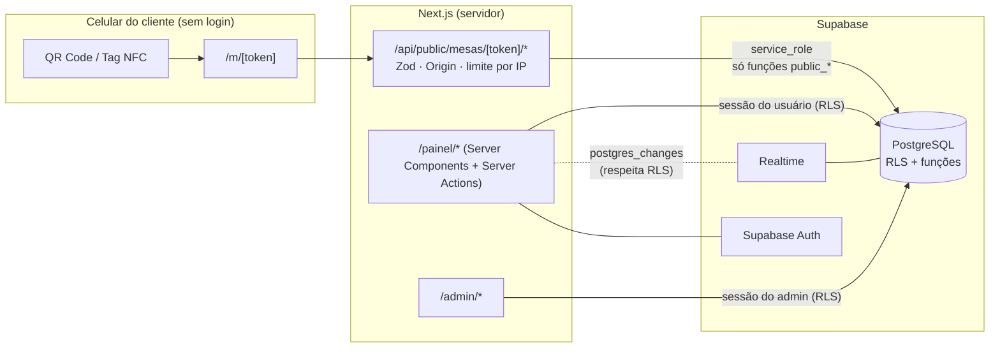
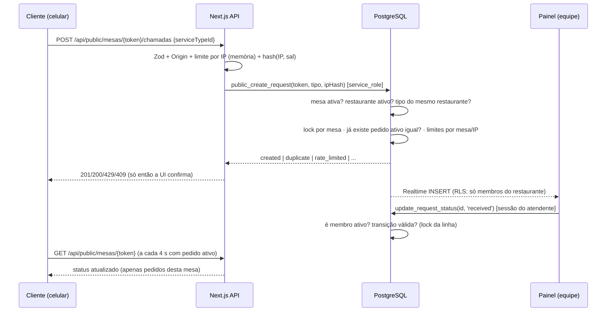
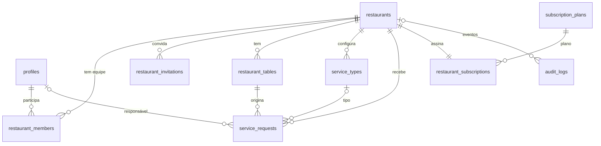

# Arquitetura do MesaOn

## Visão geral

## Decisões técnicas

| # | Decisão | Motivo |
|---|---|---|
| D1 | **Next.js 16 App Router + Server Actions** | Uma base de código para landing, cliente, painel e admin; mutações autenticadas no servidor sem API REST própria. |
| D2 | **Supabase** (Postgres + Auth + Realtime) | Banco relacional com RLS, autenticação pronta e tempo real sobre a mesma base. |
| D3 | **`cacheComponents` desativado** | Quase todas as telas dependem de sessão ou dados ao vivo. A landing usa ISR (`revalidate = 300`) e é revalidada quando o admin muda planos. Pode ser adotado depois rota a rota. |
| D4 | **Autorização no banco** (RLS + funções `SECURITY DEFINER` com checagem de papel) | A interface só esconde botões; quem decide é o banco. Mesmo um cliente que chame a API do Supabase diretamente com a sessão de um atendente não consegue fugir das regras. |
| D5 | **Fluxo público via servidor** com `service_role` restrito a 4 funções | O papel `anon` não tem acesso a nenhuma tabela de negócio. O servidor adiciona validação, checagem de origem e hash de IP; o banco aplica antiduplicidade e limites de forma atômica. |
| D6 | **Token público aleatório por mesa** (`public_token`, 96 bits) | IDs previsíveis (ex.: `/mesa/12`) permitiriam chamar de outra mesa. O token pode ser regenerado. |
| D7 | **Restaurante ativo em cookie httpOnly**, sempre validado contra os vínculos | URLs mais simples (`/painel/mesas`); trocar o cookie manualmente não dá acesso a nada (RLS). |
| D8 | **Realtime + reconexão exponencial + ressincronização + polling de 30 s** | Notificações do navegador podem estar desligadas e conexões caem; a lista é recarregada inteira ao reconectar. |
| D9 | **Componentes próprios no padrão shadcn/ui** | Evita dependência de CLI/registro externo; mantém acessibilidade (rótulos, `aria-*`, foco visível, `<dialog>` nativo). |
| D10 | **Fonte Inter auto-hospedada** | Sem requisições a terceiros (privacidade) e build reprodutível offline. |
| D11 | **Cores com contraste AA** | `#3B82F6` (azul da marca) é usado em destaques/ícones; botões com texto branco usam `#2563EB` (5,2:1). Verde/laranja da paleta são usados com texto escuro equivalente. |

## Mapa de páginas

| Rota | Quem | Conteúdo |
|---|---|---|
| `/` | público | landing, demonstração interativa (100% no navegador), planos do banco, FAQ |
| `/sobre`, `/contato`, `/termos`, `/privacidade`, `/cookies` | público | institucional e LGPD (modelos a revisar juridicamente) |
| `/cadastro`, `/entrar`, `/recuperar-senha`, `/redefinir-senha` | público | autenticação |
| `/auth/callback`, `/auth/sair` | — | retorno de e-mails (PKCE / token_hash); logout via POST |
| `/onboarding` | logado | cadastro do estabelecimento (cria proprietário, tipos padrão e plano) |
| `/convite/[token]` | público/logado | aceite de convite (e-mail precisa coincidir) |
| `/m/[token]` | cliente | chamada de atendimento e acompanhamento |
| `/painel` | equipe | indicadores do dia, mesas ativas, por tipo, recentes |
| `/painel/chamadas` | equipe | operação em tempo real |
| `/painel/historico` (+`/exportar`) | equipe (CSV: gerente+) | filtros por período, mesa, tipo, status, responsável |
| `/painel/mesas` (+`/imprimir`) | gerente+ | mesas, QR (PNG/SVG), NFC, etiquetas |
| `/painel/relatorios` | gerente+ | por dia, por hora, por tipo, por mesa, por pessoa |
| `/painel/equipe` | gerente+ | convites, papéis, desativação |
| `/painel/configuracoes` | todos (seções por papel) | tipos de atendimento, estabelecimento, conta, plano |
| `/admin/*` | administrador da plataforma | operação, restaurantes (status, plano, funcionalidades), planos, auditoria |

## Fluxo da chamada

Status: `pending → received → in_progress → completed`, com `cancelled` a partir de qualquer estado não final. A regra existe em SQL (`private.is_valid_transition`) e é espelhada em `src/lib/requests.ts`; um teste garante que as duas são idênticas.

## Modelo de dados

| Entidade pedida | Tabela | Destaques |
|---|---|---|
| Restaurants | `restaurants` | `slug` único, `timezone` validado, `status` (ativo/suspenso), `feature_overrides` |
| Profiles | `profiles` | 1:1 com `auth.users` (trigger), `is_platform_admin` não editável pela API |
| RestaurantMembers | `restaurant_members` | papel `owner/manager/attendant`, `is_active`, único por (restaurante, usuário) |
| Tables | `restaurant_tables` | `label` único por restaurante (sem diferenciar maiúsculas), `public_token` único, dados de NFC |
| ServiceTypes | `service_types` | nome, ícone, ordem, ativo |
| ServiceRequests | `service_requests` | status, `created_at/received_at/started_at/completed_at/cancelled_at`, `assigned_to`, cópias de nome da mesa/tipo para o histórico, FKs compostas garantindo mesma loja |
| SubscriptionPlans | `subscription_plans` | preço em centavos (NULL = sob consulta), limites, `features` |
| RestaurantSubscriptions | `restaurant_subscriptions` | plano vigente e situação |
| AuditLogs | `audit_logs` | ações administrativas e de equipe |
| (extra) | `restaurant_invitations` | apenas o **hash** do token |

Índices principais: chamadas por restaurante/data, chamadas ativas (parcial), por mesa, por IP (parcial), e o **índice único parcial `(table_id, service_type_id)` para status ativos**, que impede duplicidade mesmo sob concorrência.

### Funções (RPC)

| Função | Quem executa | Faz |
|---|---|---|
| `create_restaurant` | autenticado | cria restaurante + proprietário + tipos padrão + plano |
| `create_invitation` / `revoke_invitation` / `accept_invitation` / `get_invitation` | gerente+ / convidado | convites com token de 192 bits, e-mail conferido, limite do plano |
| `update_member` | gerente+ | papel/ativação (gerente só atendentes; nunca remove o último proprietário) |
| `regenerate_table_token` | gerente+ | invalida QR/NFC antigos |
| `update_request_status` | membro ativo | transições válidas, responsável e horários |
| `restaurant_stats`, `restaurant_features` | membro | indicadores e plano |
| `public_get_table`, `public_create_request`, `public_cancel_request`, `purge_request_ip_hashes` | **apenas service_role** | fluxo da mesa e LGPD |
| `admin_*` | administrador da plataforma | status, plano, funcionalidades, visão geral, uso |

Limites de plano (mesas e equipe) são aplicados por **trigger/função no banco**.

## Tempo real

1. O painel assina `postgres_changes` em `service_requests` filtrando por `restaurant_id` (a RLS do Realtime garante que só membros recebem).
2. Estados `CHANNEL_ERROR`/`TIMED_OUT`/`CLOSED` → reconexão com espera exponencial (1 s → 30 s).
3. Ao (re)conectar, ao voltar para a aba ou ao recuperar a rede: ressincronização completa pela API.
4. Rede de segurança: atualização a cada 30 s mesmo com Realtime ativo.
5. Eventos fora de ordem são descartados (`updated_at`); chamadas novas recebem destaque e som opcional (Web Audio, preferência por aparelho).

O cliente na mesa usa *polling* (4 s com pedido ativo, 15 s sem pedido, pausado em segundo plano) — ele não tem sessão e não deve ter acesso ao Realtime.

## Próximos passos sugeridos

- Gateway de pagamento e cobrança recorrente (Stripe/Pagar.me/Asaas) ligado a `restaurant_subscriptions`.
- Envio de convites por e-mail (SMTP/Resend) além do link.
- PWA do painel (instalação + Web Push opcional).
- Content-Security-Policy com *nonce*.
- Limite de frequência distribuído (Upstash/Redis) para a camada web — a camada do banco já é global.
- Domínio/subdomínio por restaurante e personalização visual (logo/cores) da página da mesa.
